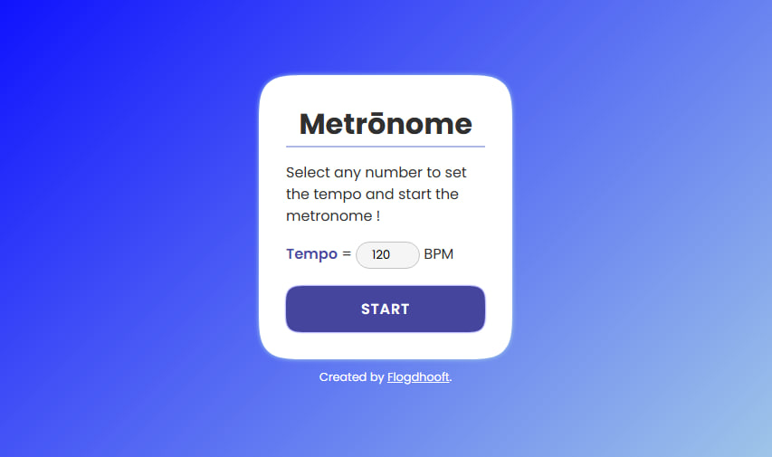

# Metronome

An **interactive web metronome** combining front-end development with my background in sound engineering. This application generates a configurable beat using the browser's native **Web Audio API**, wrapped in a responsive user interface.

**Live Demo :** [flogdhooft.github.io/Metronome](https://flogdhooft.github.io/Metronome/)



## Key Features

- **Web Audio Synthesis :** Uses the native `AudioContext` and `OscillatorNode` to generate crisp, low-latency audio clicks directly in the browser without external audio files.
- **Configurable Tempo (BPM) :** Allows users to set any tempo between **30 BPM and 300 BPM** (defaulting to 120 BPM, or 2 beats per second) with input validation and state management.
- **Clean & Responsive UI :** Features a centered card layout (`flexbox`), smooth hover/active states, and a dynamic `START` / `STOP` toggle button.

## Concepts & Technologies Applied

- **JavaScript (ES6+) :** DOM manipulation, event listeners (`click`, `input`), interval/timing logic, and application state handling.
- **Web Audio API :** Programmatic sound generation using `AudioContext` and a `700 Hz` oscillator.
- **HTML5 :** Semantic structure and accessible form controls (`<input type="number">`).
- **CSS3 :** Flexbox centering, custom styling (`border-radius`, `box-shadow`), gradient background, and interactive transitions.

## Code Structure Example

Excerpt from `script.js` handling `700 Hz` click synthesis and interval scheduling from the BPM value:

```javascript
function toggleMetronome() {
  if (!isPlaying) {
    const bpm = Number(tempoInput.value);
    const intervalle = (60 / bpm) * 1000;

    playClick();
    timerId = setInterval(playClick, intervalle);

    toggleButton.textContent = "Stop";
    toggleButton.classList.add('running');
    isPlaying = true;
  } else {
    clearInterval(timerId);
    toggleButton.textContent = "Start";
    toggleButton.classList.remove('running');
    isPlaying = false;
  }
}
